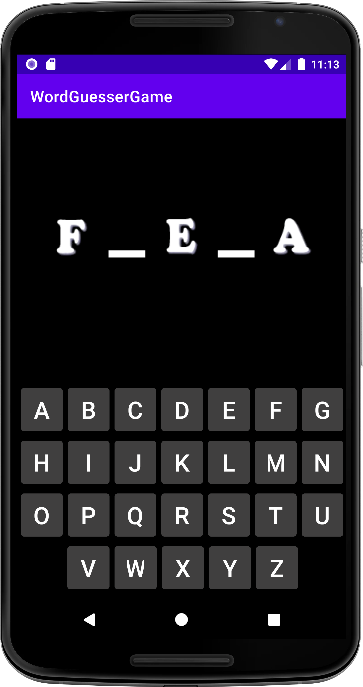
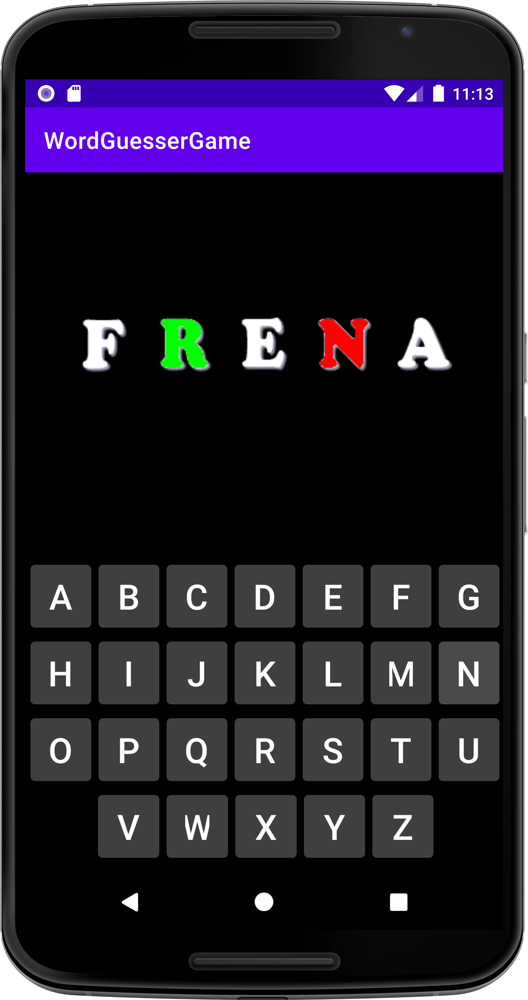
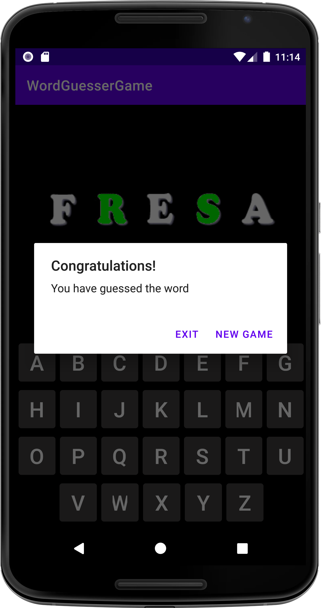

# 🔤 Word Guesser — Spanish Word Guessing Game (Kotlin + Android)

An Android game where the app picks a random five-letter Spanish word, reveals the **1st, 3rd and 5th letters**, and the player has to guess the **two hidden letters** with an on-screen keyboard.

> 🎓 **Academic project.** Built for the **Multimedia Programming and Mobile Devices** module (*Programación Multimedia y Dispositivos Móviles, PMDM*) of the **Higher National Diploma in Multiplatform Application Development** (*CFGS Desarrollo de Aplicaciones Multiplataforma, DAM*), 2nd year.

---

## 📸 Screenshots

| New game | Correct ✅ and wrong ❌ letters | Victory |
|---|---|---|
|  |  |  |

---

## ✨ Features

- **Random word** on every game, picked from a built-in list of **717 five-letter Spanish words**.
- **Partially revealed word**: `F _ E _ A` → `FRESA`. The player guesses the 2nd letter first, then the 4th.
- **Visual feedback** with custom letter graphics:
  - ✅ Correct letter → shown in **green** and kept.
  - ❌ Wrong letter → shown in **red** and cleared after one second, so the player can try again.
- **Full A–Z on-screen keyboard.**
- **End-of-game dialog** to start a **New Game** or **Exit**.
- Dark theme.

---

## 🧰 Tech Stack

| Layer | Technology |
|---|---|
| Language | **Kotlin** |
| Platform | Android (minSdk 21, targetSdk 32) |
| UI | XML layouts: `ConstraintLayout`, `LinearLayout`, `ImageView`, `Button` |
| Async | Kotlin Coroutines |
| IDE / build | Android Studio (Gradle) |

---

## 🏗️ Architecture

The whole game runs in a single `MainActivity`, which implements `View.OnClickListener`:

| Method | Responsibility |
|---|---|
| `nuevaPartida()` | Resets the game state and picks a new word |
| `inventaPalabra()` | Shuffles the word list and takes the first word |
| `mostrarPalabra()` | Shows the 1st, 3rd and 5th letters |
| `onClick()` | Checks the pressed letter against the current hidden letter |
| `borrarLetras()` | Clears wrong letters after 1 second (coroutine) |
| `check()` | Shows the victory dialog when both letters are guessed |

### Implementation details

- **Dynamic drawables**: letter images follow the pattern `<letter><state>.png` and are loaded at runtime with `resources.getIdentifier()`:

  | Suffix | Meaning | Example |
  |---|---|---|
  | `b` | neutral (*blanco*) | `ab.png` |
  | `v` | correct (*verde*) | `av.png` |
  | `r` | wrong (*rojo*) | `ar.png` |

- **One listener for 26 buttons**: instead of registering each button by hand, the activity walks the keyboard's `LinearLayout` rows and assigns the same listener to every `Button`. Each button's `tag` holds its letter.
- **Non-blocking delay**: wrong letters are cleared from a coroutine, which switches back to the main thread to update the UI.

---

## 📁 Project Structure

```
word-guesser-game/
├── app/src/main/
│   ├── java/net/azarquiel/wordguessergame/
│   │   └── MainActivity.kt          # Game logic
│   ├── res/
│   │   ├── drawable/                # Letter images (a–z × 3 states) + dash
│   │   ├── layout/activity_main.xml # Word display + keyboard
│   │   └── values/                  # Strings, colors, themes
│   └── AndroidManifest.xml
├── screenshots/
└── build.gradle / settings.gradle
```

---

## 🚀 Running Locally

### Prerequisites
- Android Studio
- Android SDK 32
- An emulator or an Android device (Android 5.0+)

### Steps
1. Clone the repository:
   ```bash
   git clone https://github.com/ivangomezr/word-guesser-game.git
   ```
2. Open the project in Android Studio and let Gradle sync.
3. Press **Run ▶** and choose an emulator or a connected device.

---

## 🙋 Author

**Iván Gómez** — [@ivangomezr](https://github.com/ivangomezr)

Developed as coursework for the *Multimedia Programming and Mobile Devices* module, DAM.
